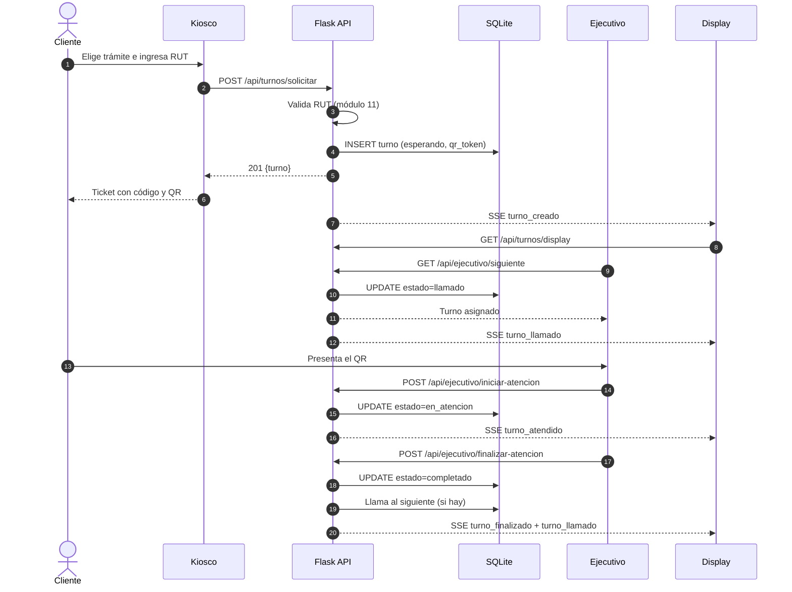
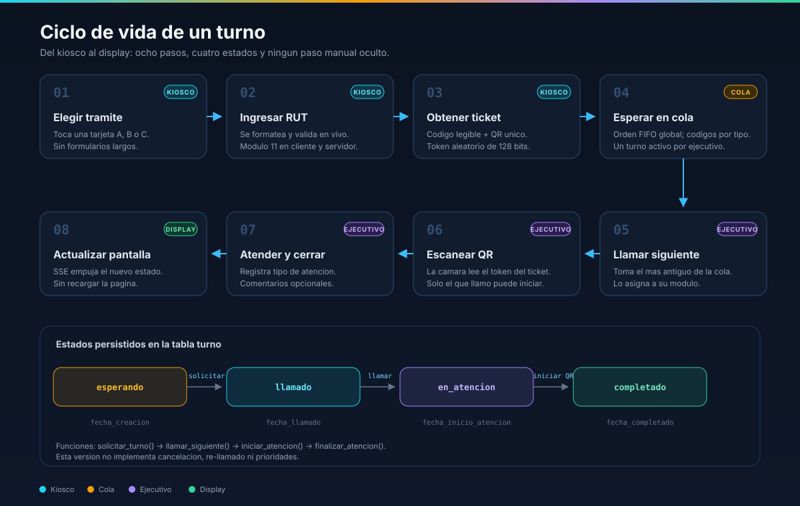
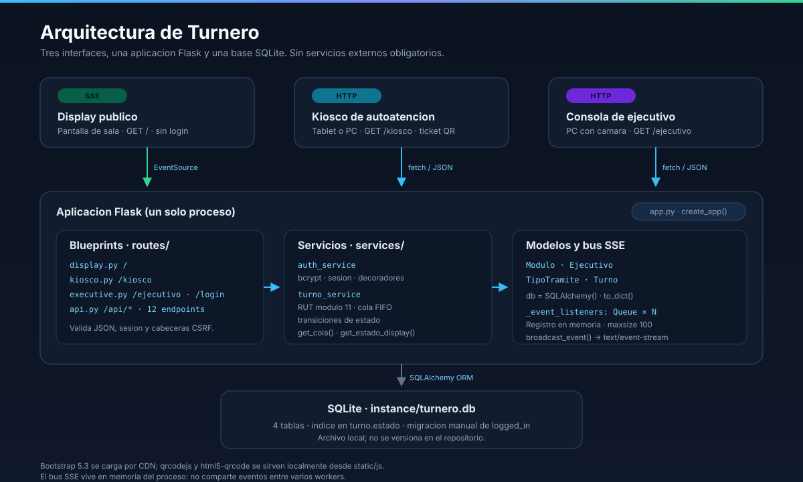
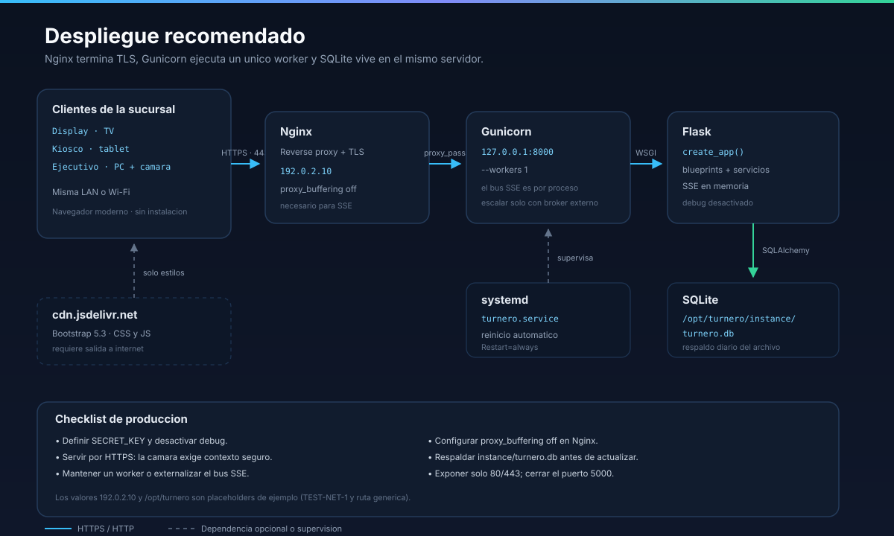
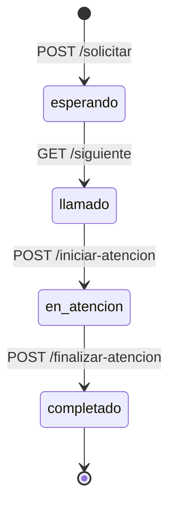
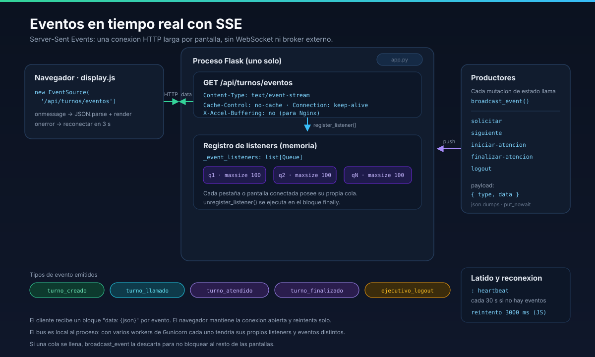

<div align="center">


# Turnero

**Sistema web de gestión de turnos para sucursales: kiosco de autoatención, cola FIFO, consola de ejecutivo y display público en tiempo real.**

[](https://www.python.org/)
[](https://flask.palletsprojects.com/)
[](https://www.sqlite.org/)
[](https://getbootstrap.com/)
[](LICENSE)
[](#limitaciones-conocidas)

[Kiosco](#uso-kiosco) · [Consola](#uso-consola-de-ejecutivo) · [Display](#uso-display-público) · [API](#api-rest) · [Manual del operador](docs/datasheet.md) · [Guía técnica](docs/developer.md)

</div>

---

## Índice

- [¿Qué es Turnero?](#qué-es-turnero)
- [El problema que resuelve](#el-problema-que-resuelve)
- [Características](#características)
- [Principio de funcionamiento](#principio-de-funcionamiento)
- [Flujo completo: del kiosco al display](#flujo-completo-del-kiosco-al-display)
- [Arquitectura](#arquitectura)
- [Stack tecnológico](#stack-tecnológico)
- [Estructura del proyecto](#estructura-del-proyecto)
- [Requisitos](#requisitos)
- [Instalación](#instalación)
- [Configuración](#configuración)
- [Credenciales de prueba](#credenciales-de-prueba)
- [Uso: kiosco](#uso-kiosco)
- [Uso: consola de ejecutivo](#uso-consola-de-ejecutivo)
- [Uso: display público](#uso-display-público)
- [API REST](#api-rest)
- [Estados del turno](#estados-del-turno)
- [SSE en profundidad](#sse-en-profundidad)
- [Seguridad](#seguridad)
- [Rendimiento y capacidad](#rendimiento-y-capacidad)
- [Solución de problemas](#solución-de-problemas)
- [Limitaciones conocidas](#limitaciones-conocidas)
- [Cómo se construyó](#cómo-se-construyó)
- [Referencias](#referencias)
- [Licencia](#licencia)

---

## ¿Qué es Turnero?

Turnero es una aplicación web monolítica escrita en Python con Flask y SQLite que organiza la atención de clientes en una sucursal. Resuelve un problema cotidiano —la fila informal— con tres interfaces que comparten una misma base de datos:

| Interfaz | Ruta | Usuario | Función |
|---|---|---|---|
| **Kiosco** | `/kiosco` | Cliente | Elige un trámite, ingresa su RUT y recibe un ticket con código y QR. |
| **Consola** | `/ejecutivo` | Ejecutivo | Inicia sesión, llama al siguiente turno, escanea el QR y cierra la atención. |
| **Display** | `/` | Público | Muestra los módulos, el turno llamado y la cola en espera, sin recargar. |

El sistema está pensado para una sucursal pequeña o mediana: una sola instancia, una base SQLite y tres tipos de trámite configurables (`A`, `B`, `C`). Es un **prototipo funcional**, no un producto certificado: demuestra el flujo completo, la máquina de estados, la validación del RUT chileno, la autenticación con bcrypt y la sincronización por Server-Sent Events (SSE), con decisiones documentadas y límites explícitos.

**Público objetivo:** equipos que quieran entender o extender un sistema de turnos real sin la complejidad de una plataforma comercial; también sirve como pieza de portfolio por la separación en capas, la API y la documentación.

---

## El problema que resuelve

En muchas sucursales la atención se ordena con una fila física o con el criterio del ejecutivo de turno. Eso produce:

- **Desorden y conflictos:** quien llegó primero no siempre es quien se atiende primero.
- **Ceguera operativa:** nadie sabe cuántos clientes esperan ni cuánto tarda cada trámite.
- **Exposición innecesaria:** el RUT se dicta en voz alta o se anota en papeles visibles.
- **Saltos de turno:** sin un registro, no hay forma de demostrar el orden de atención.

Turnero propone un circuito simple: el cliente **se autoasigna** un turno en el kiosco, el sistema lo registra en la cola, el ejecutivo lo llama desde su consola y el display comunica el llamado a toda la sala. Cada transición queda fechada en la base.

**Lo que promete:** orden FIFO, un testigo digital (QR) para verificar que quien se presenta es quien pidió el turno, y visibilidad en tiempo real sin refrescar la pantalla.

**Lo que no promete:** alta disponibilidad, multi-sucursal, aplicación móvil, firma electrónica ni integración con sistemas de gobierno. Esas ausencias están listadas en [Limitaciones conocidas](#limitaciones-conocidas).

---

## Características

**Kiosco de autoatención**

- Tarjetas de trámite generadas desde la base (`GET /api/tramites`), con fallback local si la API falla.
- Formulario de RUT con limpieza y formateo en vivo (`12.345.678-5`).
- Validación de RUT chileno en cliente y **también en servidor** (módulo 11).
- Ticket con código legible (`A1`, `B4`), trámite y QR de 200×200 px.
- Reinicio limpio para el siguiente cliente sin recargar la página.

**Cola y turnos**

- Una cola FIFO global: se atiende el turno `esperando` más antiguo, ordenado por `fecha_creacion`.
- Código correlativo por prefijo (`A1`, `A2`, `B1`…).
- Máquina de estados con cuatro estados y transiciones controladas.
- Un ejecutivo no puede llamar un segundo turno si ya tiene uno activo.
- Al finalizar, el sistema llama automáticamente al siguiente de la cola.

**Consola de ejecutivo**

- Login con usuario y contraseña; hash **bcrypt** con salt por usuario.
- Sesión Flask por cookie; cierre de sesión explícito.
- Tres vistas de atención: sin turno, turno llamado y atención en curso.
- Cronómetro MM:SS desde `fecha_inicio_atencion`.
- Escáner QR con la cámara del equipo (`html5-qrcode`, local).
- Formulario de cierre con tipo de atención y comentarios.
- Cola lateral con totales por trámite y refresco periódico.

**Display público**

- Actualización por **SSE** (`/api/turnos/eventos`), sin polling del cliente.
- Tarjetas por módulo con estado, ejecutivo y turno actual.
- Cola en espera agrupada por trámite.
- Overlay cuando no hay turnos ni módulos activos.
- Reconexión automática a los 3 segundos si se corta el stream.

**Transversal**

- API REST JSON con errores consistentes (`{"error": "..."}`).
- Protección CSRF ligera para mutaciones: `Content-Type: application/json`, header `X-Requested-With` y verificación de `Origin`/`Referer`.
- `qr_token` excluido de las respuestas públicas del display.
- Seed idempotente con tres ejecutivos y tres trámites de demostración.
- Interfaz responsive con Bootstrap 5.3 y variables CSS de marca.

---

## Principio de funcionamiento

### Códigos por trámite, una cola global

Cada `TipoTramite` tiene un prefijo (`A`, `B`, `C`). Al solicitar un turno, el servicio cuenta los turnos históricos de ese tipo y genera el siguiente código:

```text
codigo = prefijo + (count(turnos_del_tipo) + 1)
```

El turno nace en estado `esperando` con `fecha_creacion` en UTC. Cuando un ejecutivo pide "siguiente", se busca el turno **más antiguo** de estado `esperando`, sin importar el tipo, y se le asigna el módulo y el ejecutivo. Es una cola FIFO global con códigos por trámite: el cliente ve `A3`, pero el orden real lo define la fecha de creación.

### El QR es un testigo de posesión

El ticket incluye un `qr_token` aleatorio de 128 bits (`uuid.uuid4().hex`, 32 caracteres hexadecimales). El cliente lo lleva impreso en pantalla; el ejecutivo lo escanea al llamarlo. El servidor verifica que el token exista, que el turno esté en estado `llamado` y que pertenezca al ejecutivo que intenta iniciar la atención. Así se evita que alguien que escuchó el código `A3` se haga pasar por su dueño: el código es público, el token no.

### El display es una proyección, no la fuente de verdad

El display no escribe nada. Se suscribe a un bus SSE en memoria y, cuando llega un evento, vuelve a consultar el estado consolidado (`GET /api/turnos/display`) o actualiza la tarjeta del módulo. La base sigue siendo la única fuente de verdad; el evento es solo una señal de "algo cambió".

### Máquina de estados

```text
                 solicitar                llamar
   (nuevo) ──────────────▶ esperando ──────────────▶ llamado
                              │                        │
                              │                        │ iniciar (QR)
                              │                        ▼
                              │                   en_atencion
                              │                        │
                              │                        │ finalizar
                              ▼                        ▼
                           (nunca)                 completado
```

| Transición | Disparador | Efecto |
|---|---|---|
| `esperando → llamado` | `GET /api/ejecutivo/siguiente` | Asigna módulo, ejecutivo y `fecha_llamado`. |
| `llamado → en_atencion` | `POST /api/ejecutivo/iniciar-atencion` | Valida token y propiedad; fija `fecha_inicio_atencion`. |
| `en_atencion → completado` | `POST /api/ejecutivo/finalizar-atencion` | Guarda tipo, comentarios y `fecha_completado`; llama al siguiente. |

No existen transiciones hacia atrás ni cancelación desde la interfaz. Un turno `completado` es terminal.

### Por qué SQLite

El volumen esperado es de decenas a cientos de turnos por día. SQLite ofrece transacciones ACID, cero administración y un archivo único fácil de respaldar. Flask-SQLAlchemy abstrae el acceso, de modo que cambiar a PostgreSQL es una decisión de configuración (`DATABASE_URL`), no una reescritura. La contra es la concurrencia de escritura: SQLite serializa las transacciones y no es la opción para varias sucursales con escritura intensiva.

---

## Flujo completo: del kiosco al display



| Momento | Quién actúa | Qué cambia en la base | Qué ve el público |
|---|---|---|---|
| Solicitud | Cliente | Nuevo turno `esperando` | Aparece en la cola del display. |
| Llamado | Ejecutivo | `llamado`, módulo, ejecutivo | Tarjeta del módulo con el código. |
| Inicio | Ejecutivo | `en_atencion` | El módulo pasa a "En atención". |
| Cierre | Ejecutivo | `completado` y, si hay, siguiente `llamado` | El módulo se libera o muestra el nuevo turno. |



---

## Arquitectura



El proyecto usa el patrón **application factory** y separa responsabilidades en cuatro capas:

| Capa | Archivos | Responsabilidad |
|---|---|---|
| Presentación | `templates/`, `static/` | HTML, CSS y JS de las tres interfaces. |
| HTTP | `routes/` | Blueprints, validación de entrada, códigos de estado. |
| Dominio | `services/` | Reglas de negocio: RUT, códigos, estados, autenticación. |
| Persistencia | `models.py`, `instance/turnero.db` | Modelos SQLAlchemy y almacenamiento. |

Decisiones relevantes:

- **Blueprints por interfaz** (`display`, `kiosco`, `executive`, `api`) para que cada ruta viva cerca de su consumidor.
- **Servicios sin Flask request** salvo `auth_service`, que necesita la sesión. `turno_service` recibe IDs y devuelve objetos, lo que facilita probarlo.
- **Serialización explícita:** `to_dict()` para uso autenticado y `to_display_dict()` para respuestas públicas, que elimina `qr_token`.
- **Un solo proceso:** el bus SSE vive en memoria; no hay Redis ni cola externa. Es suficiente para una sucursal y una limitación documentada para escalar.
- **Sin build de frontend:** JavaScript vanilla e IIFEs; Bootstrap por CDN y las librerías QR vendorizadas en `static/js/`.

```text
Navegador (kiosco / consola / display)
        │ HTTP + SSE
        ▼
Flask (app factory + blueprints)
        │
        ├── services/  → reglas de negocio
        └── models.py  → SQLAlchemy
                │
                ▼
        instance/turnero.db (SQLite)
```

---

## Stack tecnológico

| Tecnología | Versión | Rol | Por qué |
|---|---|---|---|
| Python | 3.10+ | Lenguaje | Disponible en Linux, macOS y Windows; sintaxis clara. |
| Flask | 3.1 | Framework web | Minimalista, blueprints, SSE sin dependencias extra. |
| Flask-SQLAlchemy | 3.1 | ORM | Modelos declarativos y sesión gestionada. |
| SQLite | 3 | Base de datos | Archivo único, sin servidor, ideal para una sucursal. |
| bcrypt | 4 | Hash de contraseñas | Algoritmo lento y con salt, estándar para passwords. |
| Bootstrap | 5.3.3 | UI | Componentes responsive y utilidades sin CSS propio extenso. |
| qrcodejs | local | QR del ticket | Generación en el navegador, sin llamadas externas. |
| html5-qrcode | local | Escáner | Acceso a cámara desde el navegador con fallback. |
| SSE | nativo | Tiempo real | Unidireccional, sobre HTTP, sin WebSocket. |

Dependencias exactas (`requirements.txt`):

```text
Flask==3.1.*
Flask-SQLAlchemy==3.1.*
bcrypt==4.*
```

No se usan Node, npm, bundlers, Redis, Docker ni tareas de build. El frontend son archivos estáticos servidos por Flask.

---

## Estructura del proyecto

```text
turnero/
├── app.py                  # Factory, registro de blueprints, error 500, arranque
├── config.py               # SECRET_KEY, DATABASE_URL, advertencia de desarrollo
├── models.py               # Modulo, Ejecutivo, TipoTramite, Turno
├── seed.py                 # Datos de demostración idempotentes
├── requirements.txt        # Dependencias Python
├── generate_marketing_pdf.py # Genera el PDF del manual (fpdf2 + Playwright)
├── LICENSE                 # MIT 2026
├── README.md
├── docs/
│   ├── datasheet.md        # Manual del operador
│   ├── developer.md        # Guía técnica
│   ├── REFERENCES.md       # Fuentes y enlaces
│   ├── BITACORA.md         # Decisiones y lecciones
│   ├── assets/             # Diagramas SVG
│   └── Manual_Sistema_Turnero.pdf
├── instance/
│   └── turnero.db          # Base local (no se versiona)
├── routes/
│   ├── display.py          # GET /
│   ├── kiosco.py           # GET /kiosco
│   ├── executive.py        # GET /ejecutivo, /login
│   └── api.py              # 12 endpoints JSON + bus SSE
├── services/
│   ├── auth_service.py     # bcrypt, sesión, CSRF, decoradores
│   └── turno_service.py    # RUT, códigos, cola, estados
├── templates/
│   ├── base.html           # Layout Bootstrap
│   ├── kiosco.html
│   ├── executive.html
│   ├── login.html
│   └── display.html
└── static/
    ├── css/styles.css
    ├── img/logo.svg
    └── js/
        ├── kiosco.js
        ├── executive.js
        ├── display.js
        ├── qrcode.min.js
        └── html5-qrcode.min.js
```

`instance/turnero.db` se crea en el primer arranque y **no debe publicarse**: contiene los turnos y hashes de los ejecutivos. El repositorio lo ignora vía `.gitignore`.

---

## Requisitos

**Servidor**

- Python 3.10 o superior con `pip` y `venv`.
- 1 vCPU, 256 MB de RAM y 100 MB de disco como mínimo.
- Linux, macOS o Windows. El proyecto se desarrolló y probó en Linux.

**Clientes**

- Navegador moderno con JavaScript habilitado (Chrome, Edge, Firefox o Safari recientes).
- El display y el kiosco funcionan en pantallas de 720p o superiores; el layout es responsive.
- El escáner QR requiere cámara y un **contexto seguro**: `https://` o `http://localhost`. En una IP por HTTP el navegador bloquea `getUserMedia`.

**Conectividad**

- El servidor debe ser alcanzable por kiosco, consola y display en la misma red.
- Bootstrap se carga desde jsDelivr CDN; sin salida a internet la interfaz pierde estilos, aunque las funciones principales siguen operativas. Las librerías QR sí son locales.



---

## Instalación

```bash
# 1. Clonar el repositorio
git clone https://github.com/wanderc137/turnero.git
cd turnero

# 2. Crear y activar el entorno virtual
python3 -m venv venv
source venv/bin/activate        # Linux / macOS
venv\Scripts\activate           # Windows

# 3. Instalar dependencias
pip install -r requirements.txt

# 4. Arrancar
python app.py
```

El servidor queda en `http://127.0.0.1:5000` y muestra en consola:

```text
[*] Servidor iniciado en http://127.0.0.1:5000
```

Rutas para abrir:

| Vista | URL local |
|---|---|
| Display | `http://127.0.0.1:5000/` |
| Kiosco | `http://127.0.0.1:5000/kiosco` |
| Consola | `http://127.0.0.1:5000/ejecutivo` |

**Primer arranque.** `create_app()` ejecuta `db.create_all()`, aplica una migración manual (`ALTER TABLE ejecutivo ADD COLUMN logged_in`) si la columna falta y, si no hay ejecutivos, corre el seed con tres usuarios y tres trámites. La base se crea en `instance/turnero.db`.

**Cambiar el puerto:**

```bash
PORT=8080 python app.py
```

> **Aviso:** `python app.py` usa el servidor de desarrollo de Flask con `debug=True`. No lo expongas a internet ni lo uses como servidor de producción. Para un despliegue real, consulta la sección de despliegue en [docs/developer.md](docs/developer.md).

---

## Configuración

La aplicación se configura con variables de entorno leídas por `config.py`:

| Variable | Default | Descripción |
|---|---|---|
| `SECRET_KEY` | `turnero-secret-key-dev-2025` | Firma las cookies de sesión. **Cambiar en producción.** |
| `DATABASE_URL` | `sqlite:///turnero.db` | URI de SQLAlchemy. La ruta relativa se resuelve dentro de `instance/`. |
| `PORT` | `5000` | Puerto HTTP que usa `app.py`. |

```bash
export SECRET_KEY="$(python3 -c 'import secrets; print(secrets.token_hex(32))')"
export DATABASE_URL="sqlite:////opt/turnero/instance/turnero.db"
export PORT=8080
python app.py
```

Notas:

- Si `SECRET_KEY` conserva el valor por defecto, `config.py` emite un `RuntimeWarning`: es una clave pública conocida y permite falsificar sesiones.
- En `DATABASE_URL`, una ruta absoluta SQLite lleva **cuatro barras** (`sqlite:////ruta/absoluta.db`); una relativa lleva tres y se interpreta desde `instance/`.
- No hay carga automática de `.env`; las variables deben existir en el entorno del proceso.
- `debug=True` está fijado en `app.py`. Para producción se recomienda un WSGI como Gunicorn y desactivar debug.

---

## Credenciales de prueba

El seed crea estos usuarios **solo si la tabla `ejecutivo` está vacía**. Son credenciales de demostración, no secretos reales:

| Usuario | Contraseña | Nombre | Módulo |
|---|---|---|---|
| `carlos` | `carlos123` | Carlos Muñoz | Módulo 1 |
| `maria` | `maria123` | María González | Módulo 2 |
| `pedro` | `pedro123` | Pedro Hernández | Módulo 3 |

También crea los trámites `A` (Créditos), `B` (Consultas Generales) y `C` (Retiro de Documentos).

**Cambiar una contraseña** desde la consola interactiva:

```bash
python3
>>> from app import create_app
>>> from models import db, Ejecutivo
>>> from services.auth_service import hash_password
>>> app = create_app()
>>> with app.app_context():
...     e = Ejecutivo.query.filter_by(username="carlos").first()
...     e.password_hash = hash_password("NuevaClaveSegura")
...     db.session.commit()
```

**Reiniciar la base de demostración** (borra todos los turnos):

```bash
rm instance/turnero.db && python app.py
```

Al arrancar de nuevo se recrea el esquema y se ejecuta el seed. No hay endpoint de registro ni de recuperación de contraseña: la gestión de usuarios es manual.

**RUT de prueba:** usa `12.345.678-5`, que es ficticio y válido según el módulo 11. `12.345.678-9` es inválido y sirve para probar el rechazo. El placeholder del formulario muestra el formato, no un RUT real.

---

## Uso: kiosco

1. Abre `/kiosco` en la tablet o PC del kiosco y déjala en pantalla completa.
2. El cliente toca el trámite que necesita. Se resalta la tarjeta y avanza al paso 2.
3. Ingresa el RUT; el campo lo formatea mientras escribe. Al confirmar, el sistema valida y crea el turno.
4. La pantalla muestra el código (`A1`), el trámite y el QR. El cliente debe fotografiar o mantener visible el ticket.
5. El botón **Nuevo turno** limpia todo para el siguiente cliente.

Recomendaciones de montaje:

- Pantalla táctil de al menos 10 pulgadas, brillo alto y navegador en modo kiosco.
- Ocultar la barra de direcciones y bloquear la salida del navegador.
- Ubicar el kiosco cerca del acceso, con instrucciones impresas de uso.
- Si la tablet no tiene cámara no importa: el kiosco solo **genera** QR; la cámara se usa en la consola.

Si la API de trámites no responde, el kiosco usa un fallback local con `A`, `B` y `C` para no quedar inutilizable. Ese fallback no conoce cambios hechos en la base.

---

## Uso: consola de ejecutivo

**Ingreso.** Abre `/ejecutivo`. Sin sesión redirige a `/login`, donde se ingresa usuario y contraseña. El formulario envía `POST /api/auth/login` con JSON y `X-Requested-With: XMLHttpRequest`; si las credenciales son correctas, redirige a la consola.

**Tres vistas de atención:**

| Vista | Cuándo aparece | Acciones |
|---|---|---|
| Sin turno | No hay turno activo | **Llamar siguiente**. |
| Turno llamado | Se llamó pero no se inició | Esperar al cliente; el escáner está disponible. |
| En atención | Se escaneó el QR correcto | Cronómetro, tipo de atención, comentarios, **Finalizar**. |

**Llamar al siguiente.** `GET /api/ejecutivo/siguiente` toma el turno `esperando` más antiguo, lo marca `llamado` y lo asocia al módulo del ejecutivo. Si el ejecutivo ya tiene un turno `llamado` o `en_atencion`, la API responde `400` con "Ya tienes un turno activo". Si la cola está vacía, responde `200` con `turno: null` y la consola muestra un aviso.

**Escanear el QR.** El botón **Escanear QR** enciende la cámara trasera (`facingMode: environment`) a 10 fps con un recuadro de 250×250. Al detectar un código, la consola envía el token a `POST /api/ejecutivo/iniciar-atencion`. El servidor valida que el turno esté `llamado` y que pertenezca a ese ejecutivo; si todo coincide, pasa a `en_atencion` y arranca el cronómetro. El token se muestra truncado a 16 caracteres, nunca completo.

Requisitos del escáner:

- Cámara disponible y permiso concedido.
- Contexto seguro (`https://` o `localhost`). En una IP por HTTP el navegador no entrega la cámara.
- Buena iluminación y el QR a unos 20–30 cm.

**Finalizar.** Exige seleccionar un tipo de atención (Consulta, Contratación, Cobranza u Otro), guarda comentarios opcionales y marca el turno como `completado`. Acto seguido el servicio llama automáticamente al siguiente turno de la cola, si existe, y la consola vuelve a la vista correspondiente.

**Cola lateral.** Se refresca cada 15 segundos y el estado cada 10. No es tiempo real por SSE: la consola usa polling para mantener el código simple.

**Cerrar sesión.** `POST /api/auth/logout` marca `logged_in = false`, limpia la sesión y emite `ejecutivo_logout` para que el display retire el módulo. Cerrar la pestaña **no** cierra la sesión; el módulo puede quedar visible hasta que se use el botón.

| Mensaje en consola | Causa probable |
|---|---|
| "Usuario o contraseña incorrectos" | Credenciales inválidas o usuario inactivo. |
| "Ya tienes un turno activo" | Se intentó llamar dos veces sin finalizar. |
| "Este turno fue llamado por otro ejecutivo" | El QR pertenece a otro módulo. |
| "El turno no está en estado 'llamado'" | Se intentó iniciar un turno ya atendido o completado. |
| "No se pudo acceder a la cámara" | Permiso denegado o contexto no seguro. |

---

## Uso: display público

Abre `/` en la pantalla de la sala. El display:

- Carga el estado inicial con `GET /api/turnos/display`.
- Muestra una tarjeta por módulo activo **con un ejecutivo conectado** (`logged_in = true`).
- Indica el estado del módulo: "Llamando…", "En atención" o "Disponible".
- Muestra el código del turno actual o `---` si no hay.
- Agrupa la cola por trámite con el total en espera.
- Si no hay turnos ni módulos activos, muestra un overlay con "Sin turnos en espera".

Se actualiza por SSE: no hace falta refrescar. Si el stream se corta, `EventSource` reintenta cada 3 segundos y el display vuelve a pedir el estado completo. El latido del servidor llega cada 30 segundos para mantener viva la conexión a través de proxies.

**Privacidad:** el display no renderiza el RUT, pero sí muestra el nombre del ejecutivo y el código del turno. Además, `GET /api/turnos/display` incluye `rut_cliente` en el JSON y los eventos SSE de creación incluyen el turno completo con `qr_token`. Es una decisión consciente para simplificar el prototipo y una deuda listada en [Seguridad](#seguridad) y [Limitaciones](#limitaciones-conocidas).

---

## API REST

Todas las respuestas son JSON salvo el stream SSE. Los errores usan `{"error": "mensaje"}`. Las mutaciones requieren `Content-Type: application/json`, `X-Requested-With: XMLHttpRequest` y, si están presentes, un `Origin`/`Referer` coherente con el host.

| Método | Ruta | Auth | Cuerpo / parámetros | Respuesta |
|---|---|---|---|---|
| `POST` | `/api/auth/login` | Público + CSRF | `{username, password}` | `200 {mensaje, ejecutivo}` · `401` |
| `POST` | `/api/auth/logout` | Público + CSRF | — | `200 {mensaje}` |
| `GET` | `/api/turnos/display` | Público | — | `{modulos, cola}` |
| `GET` | `/api/turnos/eventos` | Público | — | `text/event-stream` |
| `POST` | `/api/turnos/solicitar` | Público + CSRF | `{tipo_tramite_id, rut}` | `201 {mensaje, turno}` · `400` |
| `GET` | `/api/ejecutivo/siguiente` | Sesión | — | `200 {mensaje, turno}` · `400` |
| `POST` | `/api/ejecutivo/iniciar-atencion` | Sesión + CSRF | `{qr_token}` | `200` · `400` · `404` |
| `POST` | `/api/ejecutivo/finalizar-atencion` | Sesión + CSRF | `{tipo_atencion, comentarios}` | `200 {turno_completado, turno_siguiente}` · `400` |
| `GET` | `/api/ejecutivo/cola` | Sesión | — | `{cola}` |
| `GET` | `/api/ejecutivo/estado` | Sesión | — | `{ejecutivo, turno_activo}` |
| `GET` | `/api/tramites` | Público | — | `{tramites}` |
| `GET` | `/api/modulos` | Público | — | `{modulos}` |

**Login y cookie de sesión:**

```bash
curl -s -c cookies.txt -X POST http://127.0.0.1:5000/api/auth/login \
  -H "Content-Type: application/json" \
  -H "X-Requested-With: XMLHttpRequest" \
  -d '{"username":"carlos","password":"carlos123"}'
```

**Solicitar un turno:**

```bash
curl -s -X POST http://127.0.0.1:5000/api/turnos/solicitar \
  -H "Content-Type: application/json" \
  -H "X-Requested-With: XMLHttpRequest" \
  -d '{"tipo_tramite_id":1,"rut":"12345678-5"}'
```

Respuesta (fragmento):

```json
{
  "mensaje": "Turno creado exitosamente",
  "turno": {
    "codigo": "A1",
    "rut_cliente": "12345678-5",
    "estado": "esperando",
    "qr_token": "9f2c1a7b4e8d4c6f9a0b3d5e7f1c2a4b"
  }
}
```

El `qr_token` de ejemplo es ficticio. En una respuesta real es un UUID hexadecimal de 32 caracteres.

**Llamar al siguiente:**

```bash
curl -s -b cookies.txt http://127.0.0.1:5000/api/ejecutivo/siguiente \
  -H "X-Requested-With: XMLHttpRequest"
```

**Escuchar SSE:**

```bash
curl -N http://127.0.0.1:5000/api/turnos/eventos
```

Salida:

```text
data: {"type":"turno_llamado","data":{"codigo":"A1","modulo_id":1,...}}

: heartbeat
```

Códigos de error habituales: `400` por JSON ausente, campos faltantes, RUT inválido o transición no permitida; `401` por falta de sesión; `404` por token QR inexistente; `500` por error interno (en `/api/*` siempre JSON).

---

## Estados del turno



| Estado | Significado | Quién lo ve | Campos poblados |
|---|---|---|---|
| `esperando` | En cola, sin módulo asignado. | Display y consola | `fecha_creacion`, `qr_token` |
| `llamado` | Un ejecutivo lo llamó. | Display y consola | `modulo_id`, `ejecutivo_id`, `fecha_llamado` |
| `en_atencion` | El cliente presentó el QR y está siendo atendido. | Display y consola | `fecha_inicio_atencion` |
| `completado` | Atención cerrada. | Histórico | `tipo_atencion`, `comentarios`, `fecha_completado` |

Reglas de negocio:

1. Solo se llama un turno `esperando`; el criterio es `fecha_creacion` ascendente.
2. Un ejecutivo no puede tener dos turnos activos (`llamado` o `en_atencion`).
3. Para iniciar la atención, el token debe existir, el turno debe estar `llamado` y el ejecutivo debe ser quien lo llamó.
4. Finalizar exige un turno `en_atencion` del ejecutivo; si no existe, responde `400`.
5. Al finalizar se intenta llamar al siguiente; si la cola está vacía, `turno_siguiente` es `null`.
6. No hay cancelación, rellamado, transferencia ni prioridad: son extensiones posibles, no funciones actuales.

---

## SSE en profundidad

El display usa **Server-Sent Events** en lugar de WebSocket porque el flujo es unidireccional (servidor → pantalla), viaja sobre HTTP/1.1 y el navegador reconecta solo.

**Contrato HTTP:**

```http
GET /api/turnos/eventos HTTP/1.1
Accept: text/event-stream
```

```http
HTTP/1.1 200 OK
Content-Type: text/event-stream
Cache-Control: no-cache
Connection: keep-alive
X-Accel-Buffering: no
```

**Eventos:**

| `type` | Cuándo se emite | `data` |
|---|---|---|
| `turno_creado` | Se solicita un turno | `{turno}` completo (incluye `qr_token`). |
| `turno_llamado` | Un ejecutivo llama | `{codigo, modulo_id, modulo_nombre, ejecutivo, turno}`. |
| `turno_atendido` | Se inicia la atención | `{codigo, modulo_id, turno}`. |
| `turno_finalizado` | Se cierra la atención | `{codigo, modulo_id, turno}`. |
| `ejecutivo_logout` | Un ejecutivo cierra sesión | `{ejecutivo_id}`. |



**Latido y reconexión.** El generador espera eventos con `timeout=5`; si pasan 30 segundos sin actividad, emite `: heartbeat`. `display.js` reconecta con `setTimeout(connectSSE, 3000)` ante `onerror`. Cada conexión registra una `Queue(maxsize=100)`; si una cola se llena (cliente lento), se descarta para no bloquear al resto.

**Límite importante:** el bus (`_event_listeners`) vive en memoria del proceso. Con Gunicorn y más de un worker, cada worker tiene su propio bus y un evento emitido en uno no llega a los clientes conectados a otro. Para producción: un solo worker, o un bus externo (Redis Pub/Sub) y adaptar el endpoint. Además, detrás de Nginx hace falta `proxy_buffering off` y timeouts largos para que el stream no se corte.

---

## Seguridad

**Modelo de amenaza.** El sistema asume una red local de sucursal y clientes sin privilegios. No está pensado para exponerse directamente a internet.

| Control | Implementación |
|---|---|
| Contraseñas | `bcrypt.hashpw` con salt único; nunca se guarda texto plano. |
| Sesión | Cookie firmada por Flask con `SECRET_KEY`; `HttpOnly` por defecto. |
| CSRF ligero | `csrf_protected` exige JSON, `X-Requested-With: XMLHttpRequest` y, si vienen, `Origin`/`Referer` del mismo host. |
| RUT | Validación módulo 11 en cliente y servidor; se normaliza antes de guardar. |
| QR | Token aleatorio de 128 bits; no se deduce del código público. |
| Datos públicos | `to_display_dict()` elimina `qr_token` de las respuestas del display. |
| Errores | `500` devuelve JSON genérico en `/api/*`, sin trazas al cliente. |
| Autorización | Decoradores `login_required` (redirige) y `api_login_required` (`401` JSON). |

**Riesgos conocidos y mitigaciones pendientes:**

| Riesgo | Impacto | Mitigación recomendada |
|---|---|---|
| `SECRET_KEY` por defecto | Falsificación de sesión | Definir una clave aleatoria por entorno. |
| `debug=True` | Consola interactiva expuesta | Usar Gunicorn y `debug=False`. |
| RUT visible en `/api/turnos/display` | Privacidad | Enmascarar (`12.***.***-5`) o excluirlo del payload. |
| `qr_token` en SSE `turno_creado` | Suplantación si alguien escucha el stream | Excluirlo del evento o emitir solo un identificador efímero. |
| Sin rate limiting | Fuerza bruta y spam de turnos | Limitar por IP en el proxy o con Flask-Limiter. |
| `logged_in` persistente | Módulo "fantasma" tras cerrar pestaña | Expiración por inactividad o heartbeat de sesión. |
| Sin HTTPS | Intercepción de credenciales y cámara bloqueada | TLS en el proxy; HSTS. |
| Token QR sin expiración | Reutilización de un ticket viejo | Expirar tokens y validar ventana de tiempo. |

**Checklist mínimo antes de producción:** clave secreta aleatoria, HTTPS, `debug=False`, Gunicorn con un worker o bus externo, backups de SQLite, usuario de sistema sin privilegios, firewall y monitoreo de logs.

---

## Rendimiento y capacidad

No se hicieron benchmarks formales. Las estimaciones siguientes se basan en la complejidad del código y en el comportamiento de SQLite:

| Operación | Complejidad | Comentario |
|---|---|---|
| Solicitar turno | `COUNT` + `INSERT` | `COUNT` por tipo recorre el índice del `tipo_tramite_id`. |
| Llamar siguiente | `SELECT ... ORDER BY fecha_creacion LIMIT 1` | Índice en `estado`; aceptable hasta miles de turnos. |
| Iniciar atención | `SELECT` por `qr_token` único | Índice único; O(log n). |
| Finalizar | `UPDATE` + `SELECT` siguiente | Dos transacciones breves. |
| Display inicial | 1 consulta por módulo + 1 por tipo | N+1 pequeño y acotado por la cantidad de módulos. |

Órdenes de magnitud esperados en una sucursal:

- 100–500 turnos por día; la base crece unos pocos MB al mes.
- 3–10 módulos y 3–6 tipos de trámite.
- 1–5 displays conectados por SSE.
- Latencia de evento < 100 ms en LAN.

Cuellos de botella y qué hacer:

1. **Escrituras SQLite:** se serializan. Si hay muchas altas simultáneas, migrar a PostgreSQL.
2. **`COUNT + 1`:** puede colisionar si se borran turnos. Usar una secuencia por tipo o un contador persistente.
3. **Bus SSE en un proceso:** no escala horizontalmente sin Redis.
4. **Consultas del display:** cachear el estado 1–2 segundos si hay muchos displays.
5. **Polling de la consola:** 10 s/15 s es conservador; con más ejecutivos conviene SSE también ahí.

Para una sola sucursal, un servidor de 1 vCPU y 256 MB es suficiente. El límite práctico llega por la concurrencia de escritura y por el número de conexiones SSE, no por el volumen de datos.

---

## Solución de problemas

| Síntoma | Causa probable | Solución |
|---|---|---|
| `ModuleNotFoundError: flask` | venv no activado o dependencias sin instalar | Activar `venv` y `pip install -r requirements.txt`. |
| `Address already in use` | Puerto 5000 ocupado | `PORT=8080 python app.py` o liberar el puerto. |
| El navegador no abre desde otra PC | Servidor escuchando en localhost o firewall | `app.py` usa `0.0.0.0`; verificar firewall y usar la IP del servidor. |
| La cámara no enciende | HTTP en una IP (contexto no seguro) | Usar `https://` o probar en `localhost`. |
| El QR no se genera | Librería local no cargada | Verificar `static/js/qrcode.min.js` y la consola del navegador. |
| "RUT inválido" con un RUT correcto | Dígito verificador mal calculado | Probar `12.345.678-5`; recordar que `K` es válido. |
| El display no se actualiza | SSE bloqueado por proxy o worker múltiple | Revisar `proxy_buffering off`; usar un worker. |
| Módulo "fantasma" en el display | Sesión cerrada sin logout | Usar **Cerrar sesión**; limpiar `logged_in` en la base. |
| `no such column: ejecutivo.logged_in` | Base antigua sin la columna | El arranque intenta `ALTER TABLE`; si falla, borrar la base de desarrollo. |
| `UNIQUE constraint failed: turno.codigo` | Código repetido tras borrar turnos | Reiniciar la base o corregir el generador de códigos. |
| El login responde 400 | Falta `Content-Type` o `X-Requested-With` | Enviar ambos headers, como hacen los frontends. |
| El login responde 401 | Credenciales incorrectas o usuario inactivo | Usar las credenciales del seed o revisar `activo`. |
| `RuntimeWarning` de SECRET_KEY | Se usa la clave de desarrollo | Definir `SECRET_KEY` en el entorno. |
| El PDF no se regenera | Faltan `fpdf2` o `playwright` | Instalar esas dependencias de desarrollo y los navegadores de Playwright. |
| La base se recrea vacía | Se borró `instance/turnero.db` | Es el comportamiento esperado: se vuelve a sembrar. |

Diagnóstico rápido:

```bash
# ¿El servidor responde?
curl -i http://127.0.0.1:5000/api/tramites

# ¿Qué proceso escucha el puerto?
ss -ltnp | grep 5000

# ¿La base existe y tiene tablas?
python3 -c "import sqlite3;print(sqlite3.connect('instance/turnero.db').execute(\"select name from sqlite_master where type='table'\").fetchall())"
```

---

## Limitaciones conocidas

Este proyecto es un prototipo y prefiere declarar sus límites antes que esconderlos:

1. **Una sola sucursal.** No hay tabla de sucursal ni aislamiento de datos.
2. **Sin administración web.** Tipos de trámite, módulos y ejecutivos se gestionan por seed o SQL.
3. **Códigos por `COUNT + 1`.** Borrar turnos puede provocar colisiones con la restricción `unique`.
4. **Carrera en "llamar siguiente".** Dos ejecutivos simultáneos podrían leer el mismo turno antes de que uno lo actualice; SQLite serializa la escritura, pero no la lógica check-then-act.
5. **SSE monolítico.** El bus en memoria no cruza workers ni procesos.
6. **`logged_in` no expira.** Cerrar el navegador sin logout deja el módulo visible.
7. **RUT expuesto en la API pública del display.** No se renderiza, pero viaja en el JSON.
8. **`qr_token` expuesto en SSE.** Los eventos de creación y cierre envían el turno completo.
9. **Sin cancelación ni rellamado.** Un turno solo avanza; no hay estado `cancelado`.
10. **Sin audio.** El display es visual; no anuncia por voz.
11. **Sin tests automatizados.** La verificación fue manual y por auditoría estática.
12. **Migraciones manuales.** No hay Alembic; el arranque parchea `logged_in`.
13. **Sin rate limiting.** Login y solicitud de turnos son vulnerables a abuso en LAN.
14. **Dependencias con pin de major.** `==3.1.*` y `==4.*` permiten actualizaciones menores no fijadas.
15. **Bootstrap por CDN.** Sin internet se pierde el estilo; las librerías QR sí son locales.
16. **Accesibilidad parcial.** Hay foco y etiquetas básicas, pero no se auditó con lectores de pantalla.
17. **Un solo idioma.** La interfaz está en español y no hay i18n.
18. **Sin cifrado en reposo.** SQLite guarda los datos en claro; los hashes bcrypt protegen solo contraseñas.
19. **`GET` que muta.** `GET /api/ejecutivo/siguiente` cambia el estado del turno; debería ser `POST`. Un proxy con prefetch o una reintento automático podría dispararlo sin intención.

Ninguna de estas limitaciones impide demostrar el flujo completo; varias son mejoras naturales para una segunda iteración.

---

## Cómo se construyó

El proyecto se desarrolló en un pipeline de varios roles y se corrigió con una auditoría estática antes de documentar:

1. **Análisis:** definición de las tres vistas, el modelo de datos, la API y los casos de prueba.
2. **Implementación:** Flask + SQLAlchemy, blueprints, servicios y frontend vanilla.
3. **Auditoría:** revisión de seguridad, estados, errores y consistencia; nueve hallazgos corregidos.
4. **Documentación:** README, manual del operador, guía técnica, diagramas y PDF comercial.

Hallazgos de la auditoría que quedaron en el código:

| Hallazgo | Corrección aplicada |
|---|---|
| `qr_token` viajaba al display | `to_display_dict()` lo excluye de las respuestas públicas. |
| RUT validado solo en el cliente | Validación módulo 11 también en `turno_service`. |
| Mutaciones sin protección CSRF | `csrf_protected` con JSON, header y origen. |
| Un ejecutivo podía llamar dos turnos | Verificación de turno activo antes de llamar. |
| `SECRET_KEY` fija sin aviso | Lectura de entorno y `RuntimeWarning`. |
| Nombre del módulo ausente en la plantilla | `modulo_nombre` agregado a la serialización. |
| Trámites hardcodeados en el kiosco | Endpoint `/api/tramites` con fallback local. |
| Errores 500 con HTML en rutas API | `errorhandler` que devuelve JSON en `/api/*`. |
| Faltaba `X-Requested-With` en un frontend | Header agregado en los tres clientes. |

Decisiones que se mantuvieron por simplicidad: SQLite en lugar de PostgreSQL, SSE en lugar de WebSocket, seed en lugar de panel de administración y un solo proceso en lugar de una arquitectura distribuida. Cada una tiene su costo, documentado arriba.

Lecciones: el estado persistido (`logged_in`) necesita expiración; los datos públicos deben serializarse con una función distinta; y una carrera check-then-act no se resuelve solo con una base transaccional.

---

## Referencias

**Documentación del proyecto**

- [Manual del operador](docs/datasheet.md): especificaciones, procedimientos, FAQ y mantenimiento.
- [Guía del desarrollador](docs/developer.md): arquitectura, rutas, modelos, servicios y extensión.
- [Referencias técnicas](docs/REFERENCES.md): fuentes consultadas y enlaces.
- [Bitácora](docs/BITACORA.md): decisiones, problemas y lecciones.
- [Manual comercial en PDF](docs/Manual_Sistema_Turnero.pdf).

**Fuentes externas**

- [Flask](https://flask.palletsprojects.com/) — blueprints, application factory y manejo de errores.
- [Flask-SQLAlchemy](https://flask-sqlalchemy.palletsprojects.com/) — modelos y sesión.
- [SQLAlchemy](https://docs.sqlalchemy.org/) — consultas y transacciones.
- [bcrypt](https://pypi.org/project/bcrypt/) — hash de contraseñas.
- [MDN: Server-Sent Events](https://developer.mozilla.org/es/docs/Web/API/Server-sent_events) — protocolo y `EventSource`.
- [Bootstrap 5.3](https://getbootstrap.com/docs/5.3/) — componentes y utilidades.
- [qrcodejs](https://github.com/davidshimjs/qrcodejs) — generación de QR en el navegador.
- [html5-qrcode](https://github.com/mebjas/html5-qrcode) — escaneo con cámara.
- [Servicio de Impuestos Internos: RUT](https://www.sii.cl/) — identificación tributaria chilena.
- [Algoritmo módulo 11](https://es.wikipedia.org/wiki/Anexo:Algoritmo_para_obtener_el_d%C3%ADgito_verificador) — cálculo del dígito verificador.

---

## Licencia

Distribuido bajo la licencia **MIT**. Consulta [LICENSE](LICENSE).

```text
MIT License

Copyright (c) 2026 wanderc137

Permission is hereby granted, free of charge, to any person obtaining a copy
of this software and associated documentation files (the "Software"), to deal
in the Software without restriction, including without limitation the rights
to use, copy, modify, merge, publish, distribute, sublicense, and/or sell
copies of the Software, and to permit persons to whom the Software is
furnished to do so, subject to the following conditions:

The above copyright notice and this permission notice shall be included in all
copies or substantial portions of the Software.

THE SOFTWARE IS PROVIDED "AS IS", WITHOUT WARRANTY OF ANY KIND, EXPRESS OR
IMPLIED, INCLUDING BUT NOT LIMITED TO THE WARRANTIES OF MERCHANTABILITY,
FITNESS FOR A PARTICULAR PURPOSE AND NONINFRINGEMENT. IN NO EVENT SHALL THE
AUTHORS OR COPYRIGHT HOLDERS BE LIABLE FOR ANY CLAIM, DAMAGES OR OTHER
LIABILITY, WHETHER IN AN ACTION OF CONTRACT, TORT OR OTHERWISE, ARISING FROM,
OUT OF OR IN CONNECTION WITH THE SOFTWARE OR THE USE OR OTHER DEALINGS IN THE
SOFTWARE.
```

---

<div align="center">

Hecho con Flask, SQLite y JavaScript vanilla.

**[Volver arriba](#turnero)**

</div>

